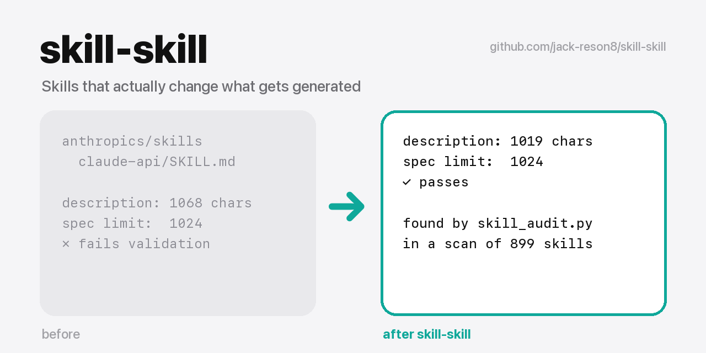
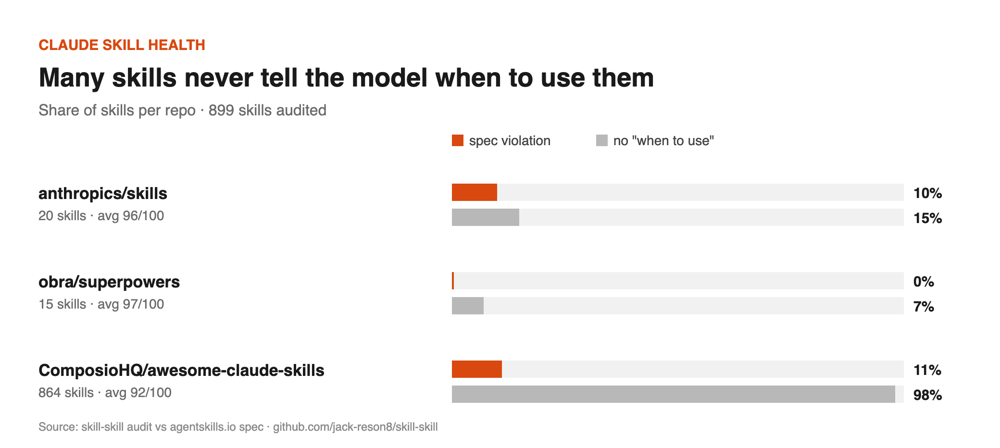

# skill-skill

[English](README.md) | [简体中文](README.zh-CN.md) | [日本語](README.ja.md) | [한국어](README.ko.md) | [Tiếng Việt](README.vi.md) | हिन्दी

<p align="center"></p>
<p align="center"><sub><a href="https://github.com/jack-reson8/copy-that"><b>Copy That</b></a> सीरीज़ का हिस्सा · एक लाइन में पूरा सेट इंस्टॉल करें</sub></p>

[](https://jack-reson8.github.io/skill-skill/check/)

स्किल लिखने के लिए एक Claude स्किल, ताकि स्किल **असल में जनरेट होने वाले नतीजे को बदले**, सिर्फ़ नोट्स का ढेर बनकर न रह जाए।

> **नया: [मैंने 899 सार्वजनिक Claude स्किल्स का ऑडिट किया](reports/2026-10/README.md)** ([中文](reports/2026-10/README.zh-CN.md))। कई स्किल्स मॉडल को यह बताती ही नहीं कि उन्हें कब इस्तेमाल करना है; सुधार upstream को भेज दिए गए हैं।
>
> [](reports/2026-10/README.md)

## यह क्या करता है

- **असली काम से निचोड़ना।** उपयोगकर्ता के सुधार, अस्वीकृतियों और स्वीकार किए गए आउटपुट को नियमों और जाँचों में बदलता है।
- **सलाह के बजाय बाध्यकारी व्यवस्था।** ज़रूरी आर्टिफ़ैक्ट, गेट, स्क्रिप्ट, तय समय पर चलने वाली चेकलिस्ट और टेम्पलेट इस्तेमाल करता है। रेफ़रेंस तभी गिने जाते हैं जब कोई स्टेप उनकी ओर इशारा करे।
- **ऐसे description और नाम जो ट्रिगर हों।** ट्रिगर वाक्यांश (चीनी सहित), 1024 अक्षरों की सीमा और नाम टकराव की जाँच शामिल है।
- **स्टैटिक ऑडिट** (`scripts/skill_audit.py`)। गलत नाम, गायब ट्रिगर क्लॉज़, नामों का टकराव, ऐसी अनाथ रेफ़रेंस फ़ाइलें जिनका कहीं ज़िक्र नहीं, टूटे हुए पाथ, बहुत लंबा बॉडी और ALL-CAPS का ज़्यादा इस्तेमाल पकड़ता है।
- **त्वरित प्रभाव परीक्षण।** 2–3 असली प्रॉम्प्ट के लिए हर एक के 3 देखने योग्य प्रभाव लिखता है, फिर स्किल के साथ और उसके बिना जाँचता है।

## इंस्टॉल करें

Claude Code में:

```
/plugin marketplace add jack-reson8/skill-skill
/plugin install skill-skill@skill-skill
```

या सामान्य स्किल फ़ोल्डर के रूप में:

```bash
git clone https://github.com/jack-reson8/skill-skill /tmp/skill-skill && cp -R /tmp/skill-skill/plugins/skill-skill/skills/skill-skill ~/.claude/skills/
```

**Codex** (CLI या ChatGPT डेस्कटॉप ऐप):

```bash
codex plugin marketplace add jack-reson8/skill-skill
codex plugin add skill-skill@skill-skill
```

या `plugins/skill-skill/skills/skill-skill` को `~/.codex/skills/` में कॉपी करें। यह स्किल खुले [Agent Skills](https://agentskills.io) मानक का पालन करती है, इसलिए Claude Code, Codex और SKILL.md पढ़ने वाले किसी भी एजेंट में चलती है।

**अन्य एजेंट** (Cursor, Gemini CLI, GitHub Copilot और skills CLI द्वारा समर्थित अन्य एजेंट):

```bash
npx skills add jack-reson8/skill-skill
```

## किसी भी स्किल का ऑडिट करें और हेल्थ स्कोर पाएँ

```bash
python3 ~/.claude/skills/skill-skill/scripts/skill_audit.py path/to/skill   # or --all for ~/.claude/skills, --badge for a README badge
```

```
== bad-skill   15/100  ★☆☆☆☆
  ✗ name "Bad_Skill" must be lowercase-hyphen
  ✗ description has no "Use when…" trigger clause
  ✗ orphan: references/orphan.md is never mentioned in SKILL.md
  ✗ dangling path: references/missing.md
  · warn: 4 ALL-CAPS commands — explain the why instead

== pro-motion   100/100  ★★★★★
  ✓ no blocking issues

Average skill health: 92/100 across 6 skills
```

किसी भी सार्वजनिक रेपो का ऑडिट करके चार्ट के साथ रिपोर्ट बनाएँ: `python3 scripts/skill_report.py owner/repo`.

स्कोर मिल गया? बैज को अपनी स्किल के README में लगाएँ और शेयर करें (`--badge` markdown प्रिंट करता है)।

Python 3 के अलावा किसी निर्भरता की ज़रूरत नहीं। पूरे eval बेंचमार्क और description ऑप्टिमाइज़ेशन के लिए इसे Anthropic के `skill-creator` के साथ इस्तेमाल करें।

## अक्सर पूछे जाने वाले सवाल

**Claude मेरी स्किल इस्तेमाल क्यों नहीं करता?** Claude सिर्फ़ `description` देखकर तय करता है। लिखें कि स्किल क्या करती है *और कब इस्तेमाल करनी है*, उन्हीं शब्दों में जो आपके उपयोगकर्ता सच में टाइप करते हैं, और 1,024 अक्षरों से कम रखें। `skill_audit.py` ऐसे description चिह्नित करता है जो यह शर्त पूरी नहीं करते।

**SKILL.md के नाम के नियम क्या हैं?** नाम 1–64 छोटे अक्षरों, अंकों और अकेले हाइफ़न का होना चाहिए, और पैरेंट फ़ोल्डर के नाम से मेल खाना चाहिए ([Agent Skills स्पेसिफ़िकेशन](https://agentskills.io/specification))।

**यह Anthropic के skill-creator से कैसे अलग है?** skill-creator पूरे eval चलाता है और description को ऑप्टिमाइज़ करता है। skill-skill तेज़ रास्ता है: असली काम को बाध्यकारी व्यवस्था में बदलता है और सेकंडों में स्टैटिक लिंट देता है। दोनों इस्तेमाल करें।

प्रोजेक्ट पेज: https://jack-reson8.github.io/skill-skill/

## लाइसेंस

MIT
